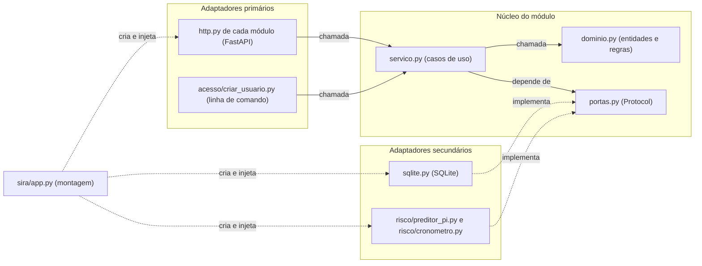
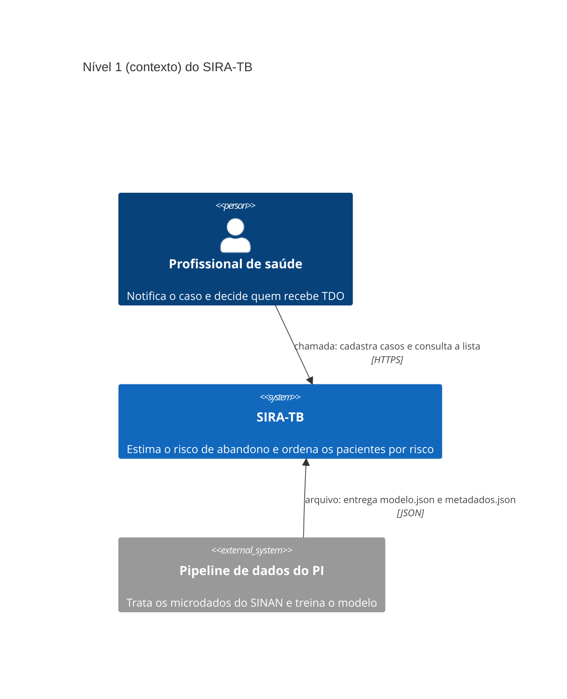
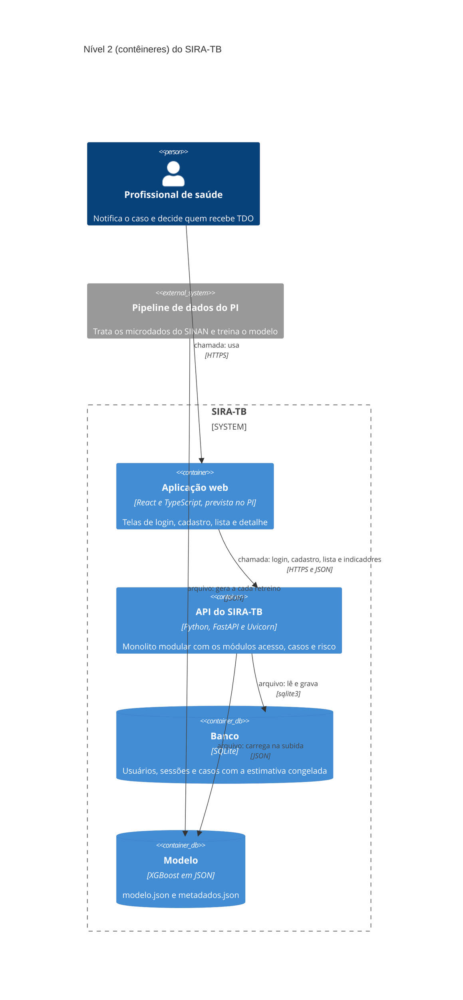
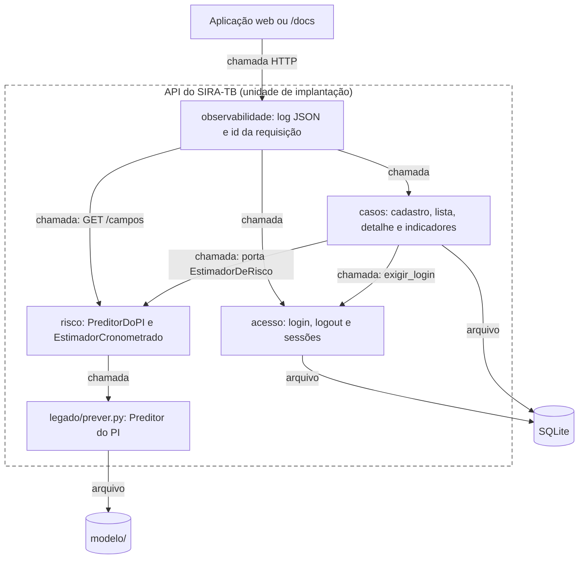
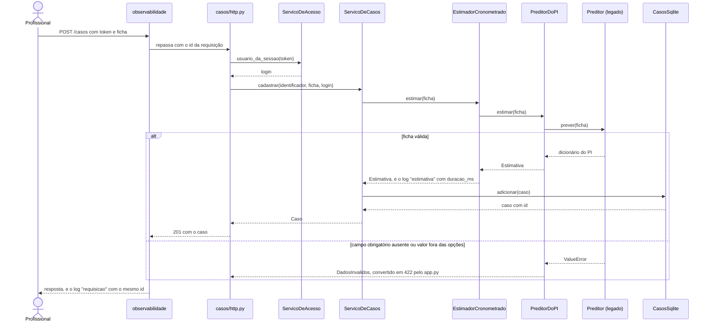

# 3. Arquitetura

## Plano macro: monolito modular

O SIRA-TB é um monolito modular (livro, capítulo 6): uma única aplicação FastAPI, implantada como um processo, dividida nos módulos `acesso`, `casos` e `risco`, cada um com a interface pública no próprio `__init__.py` (ADR 0001).

**Quando adotar (seção 6.5).** O livro indica o estilo para sistema novo cujo domínio ainda está sendo descoberto, quando o time cabe em uma ou duas equipes e a organização não tem plataforma de operação madura. É o nosso caso, com quatro pessoas, nenhuma infraestrutura além do computador de cada um e um domínio que ainda vai ganhar os módulos de carteira e de análise territorial no TCC. A seção também cita a intenção real de extrair serviços no futuro, e o módulo `risco` é o candidato natural, porque o resto do sistema só fala com ele pela porta `EstimadorDeRisco`.

**Quando evitar (seção 6.6).** O estilo perde quando times diferentes precisam publicar em ritmos diferentes ou quando uma parte exige máquina diferente, e nada disso acontece aqui: o modelo roda em CPU comum em algumas dezenas de milissegundos. O erro de adoção que o livro aponta, pastas renomeadas sem nenhuma verificação, é coberto pela função de aptidão em [tests/test_arquitetura.py](https://github.com/Mendes2719/grupo-01-pas-sira-tb/blob/a8ccb5169aefabbaa21390a2744514864ffefa0b/tests/test_arquitetura.py#L21-L34), que roda no CI e falha quando um módulo importa o interno de outro:

```python
def interno_de_outro_modulo(nome: str, modulo: str) -> bool:
    partes = nome.split(".")
    return partes[0] == "sira" and len(partes) > 2 and partes[1] in MODULOS - {modulo}
```

**Custo real (seção 6.7).** A operação é a de um artefato só, igual à do monolito em camadas, e o teste de cada módulo roda rápido, sem ambiente distribuído. O custo que pagamos é de time e de governança: revisar a fronteira em cada PR, manter a interface pública pequena e manter o teste de arquitetura.

## Plano interno: portas e adaptadores em cada módulo

Dentro de cada módulo o código segue a arquitetura hexagonal (capítulo 7 e ADR 0002). O domínio e o serviço ficam no centro e declaram as portas como `Protocol`, os adaptadores de HTTP, SQLite e modelo ficam na borda e implementam essas portas, e `sira/app.py` é o único ponto que conhece as classes concretas e monta tudo ([app.py](https://github.com/Mendes2719/grupo-01-pas-sira-tb/blob/a8ccb5169aefabbaa21390a2744514864ffefa0b/sira/app.py#L32-L41)). O módulo `risco` não tem serviço próprio, porque a porta é atendida direto pelo adaptador do preditor do PI.



| Parte | Pasta ou arquivo |
|---|---|
| Domínio | `sira/acesso/dominio.py`, `sira/casos/dominio.py`, `sira/risco/dominio.py` |
| Portas | `sira/acesso/portas.py`, `sira/casos/portas.py`, `sira/risco/portas.py` |
| Serviços (casos de uso) | `sira/acesso/servico.py`, `sira/casos/servico.py` |
| Adaptadores primários | `sira/*/http.py` e `sira/acesso/criar_usuario.py` |
| Adaptadores secundários | `sira/acesso/sqlite.py`, `sira/casos/sqlite.py`, `sira/risco/preditor_pi.py`, `sira/risco/cronometro.py` |
| Montagem | `sira/app.py` |
| Apoio compartilhado | `sira/banco.py` e `sira/observabilidade.py` |
| Legado do PI | `legado/prever.py` |

## Estilos considerados e descartados

**Microsserviços (capítulo 9).** No PI o modelo já tinha uma API própria e a aplicação web estava prevista como outra unidade, então separar risco, casos e acesso em serviços era o caminho mais óbvio. Descartamos porque nenhuma parte precisa de implantação ou escala independente, e cada cadastro passaria a depender de uma chamada de rede ao serviço de risco, com timeout, nova tentativa e falha parcial para tratar, um custo de operação alto para uma equipe de quatro pessoas sem plataforma para isso.

**Monolito em camadas (capítulo 5).** É o arranjo padrão de uma API FastAPI, com rota, serviço e repositório. Descartamos porque o corte por camada técnica deixaria login, casos e modelo na mesma camada de negócio, sem fronteira para os módulos do TCC, e o serviço importaria o SQLite e o XGBoost direto, o que deixaria o teste das regras preso à infraestrutura.

## C4

Os níveis 1 e 2 usam a sintaxe C4 do Mermaid e o nível 3 usa diagrama de fluxo, como os modelos do apêndice B.4. Cada conector traz o tipo no rótulo. As fontes estão em [`diagrams/`](../diagrams).

### Nível 1, contexto



### Nível 2, contêineres

A aplicação web ainda não existe e está no diagrama porque é ela que vai consumir a API; enquanto isso, a API é usada pela documentação interativa em `/docs`.



### Nível 3, componentes da API



## Sequência do cadastro de um caso

O fluxo central do sistema é o cadastro, que já devolve a estimativa ao profissional.


