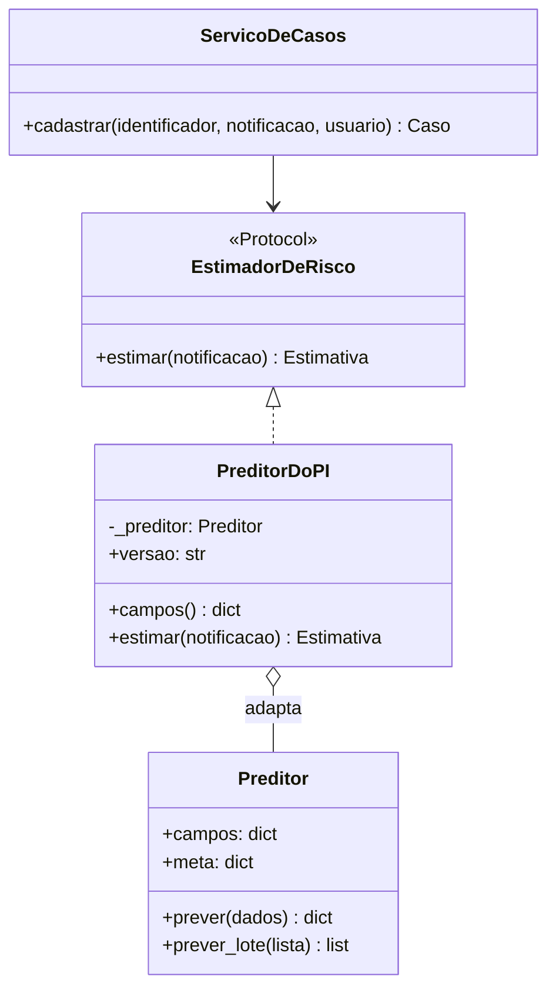
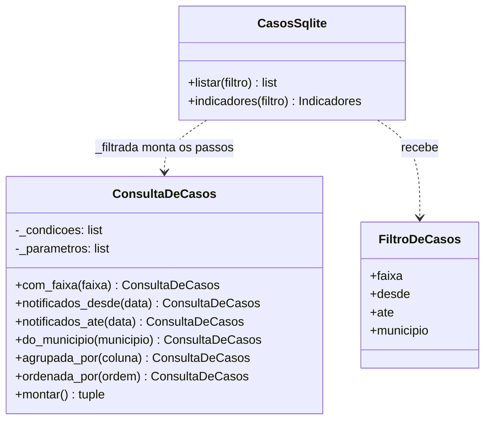
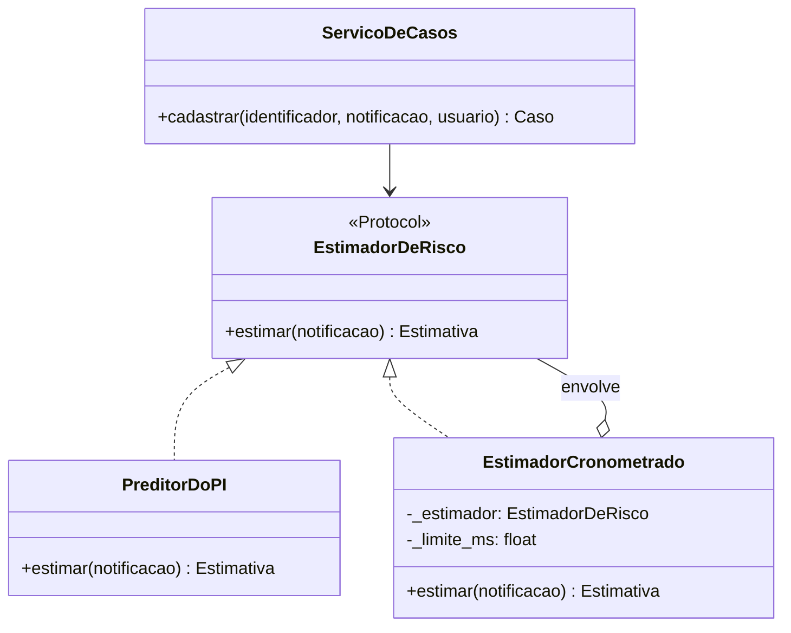

# 6. Padrões GoF

Os três padrões seguem o catálogo do [Refactoring Guru](https://refactoring.guru/pt-br/design-patterns), com os nomes e as categorias de lá.

## Adapter (estrutural)

**Problema no projeto.** O preditor do PI, em `legado/prever.py`, devolve um dicionário com a faixa em texto sem acento, os fatores com campos técnicos como o peso em log-odds e lança `ValueError` quando a ficha está errada. Os módulos novos esperam uma `Estimativa` pela porta `EstimadorDeRisco` e um erro do domínio. Reescrever o preditor estava fora de questão, porque a equivalência dele com o pipeline de treino já foi validada no PI (ADR 0003), então as duas interfaces precisavam conversar sem que nenhuma mudasse.

**Onde está.** [sira/risco/preditor_pi.py](https://github.com/Mendes2719/grupo-01-pas-sira-tb/blob/da5dd7efa431ac0fb08a0b0001dfb98f717ff281/sira/risco/preditor_pi.py#L7-L32), introduzido no [PR #5](https://github.com/Mendes2719/grupo-01-pas-sira-tb/pull/5):

```python
def estimar(self, notificacao: dict) -> Estimativa:
    try:
        resposta = self._preditor.prever(notificacao)
    except ValueError as erro:
        raise DadosInvalidos(str(erro)) from erro
    return Estimativa(
        probabilidade=resposta["probabilidade"],
        faixa=FaixaDeRisco(resposta["faixa"]),
        percentil=resposta["percentil"],
        fatores=tuple(_traduzir_fator(fator) for fator in resposta["fatores"]),
        avisos=tuple(resposta["avisos"]),
        versao_modelo=self.versao,
    )
```



**Benefício.** O legado continua byte a byte igual ao validado, e o resto do sistema não conhece dicionário do PI, XGBoost nem pandas. Os testes de casos trocam o adaptador por um estimador falso.

**Custo.** Mais uma classe e uma tradução escrita à mão que precisa acompanhar o formato de saída do legado. O que o adaptador descarta, como o peso SHAP e a probabilidade de partida, só volta a aparecer se o adaptador mudar.

## Builder (criacional)

**Problema no projeto.** A lista priorizada aceita quatro filtros opcionais e combináveis (RF12), e os indicadores precisam exatamente do mesmo recorte para conferir com a lista (RF14). Montar as condições com uma cadeia de `if` em cada consulta duplicaria a regra e deixaria as duas consultas livres para divergir.

**Onde está.** [sira/casos/sqlite.py](https://github.com/Mendes2719/grupo-01-pas-sira-tb/blob/da5dd7efa431ac0fb08a0b0001dfb98f717ff281/sira/casos/sqlite.py#L35-L73), introduzido no [PR #11](https://github.com/Mendes2719/grupo-01-pas-sira-tb/pull/11). A `ConsultaDeCasos` é o builder, cada método é um passo que só acrescenta a condição se o filtro foi informado, e a função `_filtrada` faz o papel de diretor, com a sequência fixa de passos que a lista e os indicadores usam ([linhas 93 a 115](https://github.com/Mendes2719/grupo-01-pas-sira-tb/blob/da5dd7efa431ac0fb08a0b0001dfb98f717ff281/sira/casos/sqlite.py#L93-L115)):

```python
class ConsultaDeCasos:
    def com_faixa(self, faixa: FaixaDeRisco | None) -> Self:
        return self._condicao("faixa = ?", faixa.value if faixa else None)

    def montar(self) -> tuple[str, list[str]]:
        onde = f" WHERE {' AND '.join(self._condicoes)}" if self._condicoes else ""
        return f"{self._selecao}{onde}{self._agrupamento}{self._ordem}", self._parametros
```

```python
consulta = _filtrada(selecao, filtro).agrupada_por("faixa")
```



**Benefício.** As condições ficam em um lugar só, e a lista e os indicadores não têm como divergir, o que o teste `test_indicadores_conferem_com_a_lista_filtrada` confere. Um filtro novo é um método na `ConsultaDeCasos` e uma linha em `_filtrada`, e os indicadores ficaram com seis linhas.

**Custo.** O SQL final não aparece inteiro em nenhum lugar do código, então para ler a consulta é preciso seguir os passos. Também é mais uma classe, e os trechos de SQL montados com f-string pedem cuidado: só entram constantes do próprio código, e os valores sempre vão como parâmetros.

## Decorator (estrutural)

**Problema no projeto.** O RNF03 limita a estimativa a 1 segundo, e para saber se o limite vale em uso real é preciso medir cada estimativa. Colocar a medição dentro do `PreditorDoPI` misturaria tradução com medição, e colocar no `ServicoDeCasos` misturaria a regra do cadastro com métrica.

**Onde está.** [sira/risco/cronometro.py](https://github.com/Mendes2719/grupo-01-pas-sira-tb/blob/da5dd7efa431ac0fb08a0b0001dfb98f717ff281/sira/risco/cronometro.py#L14-L26), introduzido no [PR #14](https://github.com/Mendes2719/grupo-01-pas-sira-tb/pull/14), e a montagem em [app.py](https://github.com/Mendes2719/grupo-01-pas-sira-tb/blob/da5dd7efa431ac0fb08a0b0001dfb98f717ff281/sira/app.py#L35):

```python
def estimar(self, notificacao: dict) -> Estimativa:
    inicio = perf_counter()
    estimativa = self._estimador.estimar(notificacao)
    duracao_ms = round((perf_counter() - inicio) * 1000, 1)
    nivel = logging.WARNING if duracao_ms > self._limite_ms else logging.INFO
    dados = {"duracao_ms": duracao_ms, "versao_modelo": estimativa.versao_modelo}
    log.log(nivel, "estimativa", extra={"dados": dados})
    return estimativa
```

```python
casos = ServicoDeCasos(CasosSqlite(CAMINHO), EstimadorCronometrado(preditor))
```



**Benefício.** A medição entrou sem alterar nenhuma classe existente e pode ser tirada mudando uma linha da montagem. Como o decorador implementa a mesma porta, dá para empilhar outro por cima se precisar.

**Custo.** Mais um nível de indireção: quem depura a estimativa passa pelo decorador antes de chegar ao adaptador, e o rastro da exceção fica maior. A ordem da composição em `app.py` também passa a importar, porque o serviço só enxerga o objeto mais externo.
